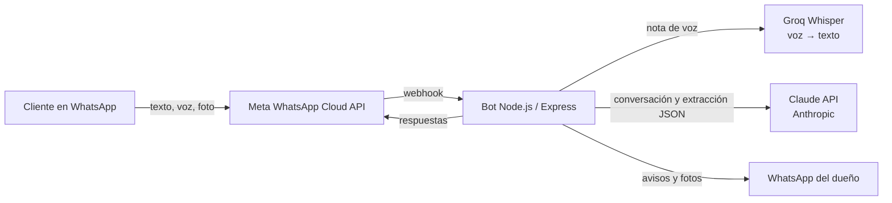

# WhatsApp IA Bot: asistente de ventas con IA y voz para negocios

Bot de WhatsApp que **atiende clientes, toma pedidos y asesora con IA**, y le avisa al dueño del negocio con todo listo para cerrar la venta. Entiende **texto y notas de voz** y funciona 24/7 en la nube.

Este repositorio es la **versión de demostración**, configurada con un negocio ficticio (*Casa Luna*). El mismo código funciona **en producción** para un negocio real: ver el [caso Siempre Regia](#-caso-real-siempre-regia).

---

## 🏆 Caso real: Siempre Regia

**Siempre Regia** es un negocio familiar de Barranca (Perú) con dos líneas: tortas personalizadas (*Dulcemente Regia*) y asesoría en bebidas funcionales FuXion. Antes, la dueña respondía a mano las mismas preguntas todo el día. Ahora el bot:

- **Toma los pedidos de tortas completos.** El cliente responde un cuestionario como quiera (todo junto, por partes o en una nota de voz) y la IA ordena los datos: fecha, hora, porciones, temática, sabor y foto de referencia.
- **Hace la asesoría de bebidas.** Pregunta los objetivos del cliente, recomienda combinaciones según las fichas del fabricante y respeta sus advertencias.
- **Le avisa a la asesora por WhatsApp** de cada pedido y cliente interesado, con la foto y un enlace para escribirle al cliente.
- **Aplica las reglas del negocio:** no da precios ni promete curas, y deriva a la asesora cuando corresponde.

> Funciona en producción con el número oficial del negocio. *(Aquí va el video demo grabado con la dueña.)*

## ✨ Funciones

| Función | Detalle |
|---|---|
| 📝 **Pedido por cuestionario** | Un solo mensaje con todas las preguntas. La IA extrae cada dato con **salida JSON estructurada** (el esquema sale de la configuración) y el bot pide solo lo que falta. Valida mínimos y recibe fotos de referencia. |
| 💬 **Asesoría con IA** | Tipos de cliente configurables (por ejemplo, cliente nuevo, club con promociones o revendedor). La IA recomienda con las fichas reales de los productos, sin inventar dosis ni precios. |
| 🎙️ **Notas de voz** | Transcripción con **Whisper (Groq)**; el audio se procesa igual que un texto. |
| 🔔 **Avisos al dueño** | Cada pedido o prospecto llega por WhatsApp con un enlace `wa.me`. Fuera de la ventana de 24 h usa una **plantilla aprobada por Meta**, y las fotos esperan hasta que el dueño vuelva a escribir. |
| 🛡️ **Reglas de negocio en código** | Precios, mínimos y derivaciones se controlan con lógica determinista: la IA no puede saltarse una regla. |
| 🔒 **Privacidad** | Política de privacidad pública en `/privacidad` (requisito de Meta) y pedido de "eliminar mis datos". |

## 🧩 Un bot, muchos negocios

Todo lo propio de un negocio vive en **`src/negocio/`**. El código no cambia entre clientes:

```
src/negocio/
├── negocio.js      # Textos del bot, campos del pedido, tipos de cliente, reglas de la IA
├── contexto.md     # Información del negocio en lenguaje natural (la edita el dueño)
├── fichas.json     # Ficha de cada producto: qué es, ingredientes, modo de uso, advertencias
└── catalogo.json   # Catálogo por categorías (referencia interna)
```

Por ejemplo, el pedido de Casa Luna se define así:

```js
campos: [
  { clave: 'fecha', icono: '📅', nombre: 'Fecha de entrega', descripcion: 'fecha en que necesita la torta' },
  { clave: 'porciones', icono: '🍰', nombre: 'Número de porciones', numero: true, minimo: 15 },
  { clave: 'tematica', icono: '🎨', nombre: 'Temática o diseño', descripcion: 'temática o diseño' },
  // ...
],
```

De esa lista salen el cuestionario que ve el cliente, el esquema JSON que usa la IA para leer las respuestas, la validación del mínimo y el resumen que le llega al dueño.

## 🏗️ Arquitectura



1. Un **menú con estado** por cliente (sesiones con expiración) guía cada flujo: pedido, asesoría o menú principal.
2. Las **palabras clave** y los nombres de producto llevan al cliente al flujo correcto aunque no use el menú.
3. La **IA se usa donde aporta**: preguntas libres, asesoría y lectura de respuestas desordenadas. El resto es lógica determinista, más barata y predecible.
4. El prompt del sistema se **cachea**, así cada mensaje cuesta una fracción de centavo.

## 🧰 Tecnologías

- **Node.js 20+ y Express 5**: servidor y webhook.
- **WhatsApp Cloud API (Meta)**: mensajes, plantillas y archivos.
- **Claude API (Anthropic SDK)**: conversación, asesoría y extracción estructurada (`output_config.format` con JSON Schema).
- **Groq (Whisper large v3 turbo)**: notas de voz en español.
- **Render**: despliegue continuo desde GitHub.

## 🚀 Probarlo en 2 minutos

```bash
git clone https://github.com/jesusmndz-code/whatsapp-ia-bot.git
cd whatsapp-ia-bot
npm install
cp .env.example .env
npm run dev
```

**Sin ninguna clave** el bot funciona en modo simulación: usa el menú y muestra las respuestas en la consola. Con `ANTHROPIC_API_KEY` se activa la IA. Pruébalo sin WhatsApp:

```bash
curl -X POST localhost:3000/simular -H "Content-Type: application/json" \
  -d '{"telefono": "prueba", "texto": "quiero una torta"}'
```

### Variables de entorno

| Variable | Para qué |
|---|---|
| `WHATSAPP_TOKEN` | Token permanente de la app de Meta |
| `WHATSAPP_PHONE_NUMBER_ID` | ID del número de WhatsApp del negocio |
| `WEBHOOK_VERIFY_TOKEN` | Texto secreto para que Meta verifique el webhook |
| `ANTHROPIC_API_KEY` | Clave de Claude (sin ella, el bot usa solo el menú) |
| `GROQ_API_KEY` | Clave de Groq para las notas de voz |
| `ASESORA_TELEFONO` | WhatsApp del dueño que recibe los avisos (código de país, sin `+`) |
| `NODE_ENV` | `production` en el servidor (desactiva `/simular`) |

### Despliegue

1. Conectar el repositorio a **Render** (Web Service: `npm install` / `npm start`) y cargar las variables con `NODE_ENV=production`.
2. En Meta, apuntar el webhook a `https://<tu-servicio>.onrender.com/webhook` y suscribir la cuenta de WhatsApp a la app.
3. Crear la plantilla de utilidad `aviso_asesora` (idioma `es`, variables `{{1}}` = detalle y `{{2}}` = enlace al cliente) para los avisos fuera de la ventana de 24 h.

## 💡 Decisiones y aprendizajes

- **IA donde aporta, reglas donde conviene.** Las reglas del negocio viven en el código, no en el prompt.
- **Salida estructurada en lugar de pasos rígidos.** El cuestionario pasó de "una pregunta por mensaje" a "un mensaje que se responde como quieras". El JSON Schema garantiza el formato de la extracción.
- **La ventana de 24 h de WhatsApp.** El bot intenta primero un mensaje normal, que es gratis, y usa la plantilla solo cuando hace falta.
- **Configuración separada del código.** Convertir el bot de un cliente en un producto reutilizable fue mover los datos a `src/negocio/`, sin duplicar lógica.
- **Contenido responsable.** Las afirmaciones de salud del material de ventas se revisaron contra las fichas del fabricante.

## 🗺️ Próximos pasos

- [ ] Guardar sesiones y pedidos en una base de datos.
- [ ] Panel web para que el dueño vea los pedidos del día.
- [ ] Varios negocios en un mismo servidor (un `negocio` por número de WhatsApp).
- [ ] Respuestas con voz para los clientes que envían notas de voz.

## 👤 Autor

**Jesús Mendoza**: bots de WhatsApp e integraciones con IA para negocios.
[LinkedIn](https://www.linkedin.com/in/jesus-mendoza-15a393291) · ¿Quieres un bot así para tu negocio? Escríbeme.

Licencia MIT.
